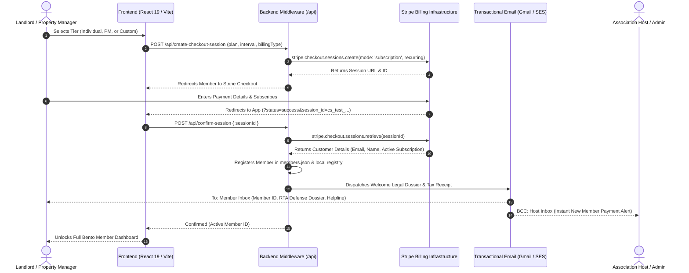
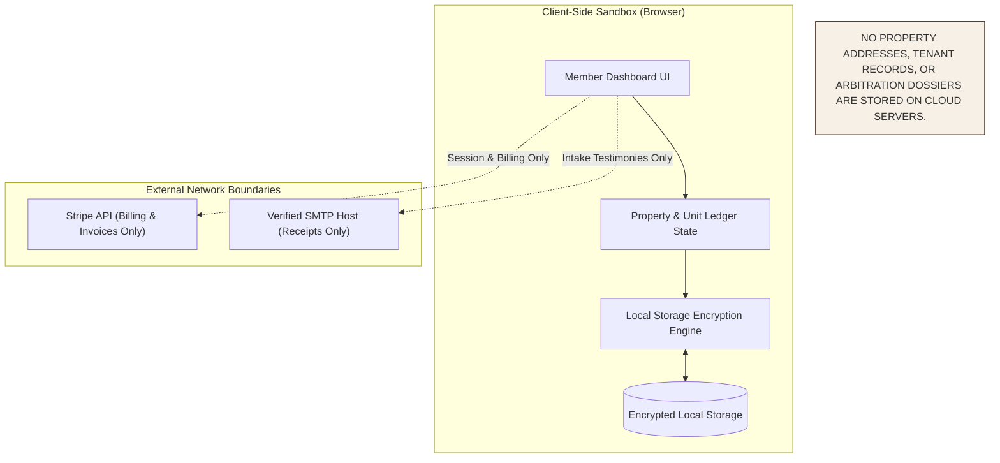

# Landlords BC — Legal Defense & Statutory Compliance Portal

[](https://react.dev/)
[](https://www.typescriptlang.org/)
[](https://vitejs.dev/)
[](https://tailwindcss.com/)
[](https://stripe.com/)
[-2e6b3b)](https://www.bclaws.gov.bc.ca/civix/document/id/complete/statreg/02078_01)
[](https://www.canada.ca/en/revenue-agency/services/forms-publications/publications/t4036.html)
[](#disclaimer--legal-notice)

A modern, privacy-first statutory compliance portal, legal defense passport, and documentation vault engineered specifically for British Columbia residential housing providers operating under the **BC Residential Tenancy Act [SBC 2002] c. 78 (RTA)** and the **Residential Tenancy Branch (RTB)** arbitration framework.

---

## 📑 Table of Contents

- [1. Executive Overview & Purpose](#1-executive-overview--purpose)
- [2. System Architecture & Workflows](#2-system-architecture--workflows)
  - [Subscription & Automated Onboarding Lifecycle](#subscription--automated-onboarding-lifecycle)
  - [Zero-Disclosure Client Vault Architecture](#zero-disclosure-client-vault-architecture)
- [3. Membership Tiers & Billing Specifications](#3-membership-tiers--billing-specifications)
- [4. Member Association Bento Dashboard](#4-member-association-bento-dashboard)
  - [Interactive 5-Card Layout](#interactive-5-card-layout)
  - [Card 1: Member Legal Defense Passport](#card-1-member-legal-defense-passport)
  - [Card 2: Official RTB Statutory Gateway](#card-2-official-rtb-statutory-gateway)
  - [Card 3: Billing & CRA Tax Deductible Invoices](#card-3-billing--cra-tax-deductible-invoices)
  - [Card 4: Private Property Vault & Unit Ledger](#card-4-private-property-vault--unit-ledger)
  - [Card 5: 2026 Statutory Rent Increase Engine](#card-5-2026-statutory-rent-increase-engine)
- [5. Interactive In-Page Mini Screens](#5-interactive-in-page-mini-screens)
- [6. Automated Transactional Email Engine](#6-automated-transactional-email-engine)
- [7. CRA Real Estate Rental Tax Compliance (Form T776)](#7-cra-real-estate-rental-tax-compliance-form-t776)
- [8. Technology Stack](#8-technology-stack)
- [9. Project Directory Structure](#9-project-directory-structure)
- [10. Complete API Reference](#10-complete-api-reference)
- [11. Quick Start & Local Development](#11-quick-start--local-development)
- [12. Stripe Test Mode & Production Migration Guide](#12-stripe-test-mode--production-migration-guide)
- [13. Production Deployment Guide](#13-production-deployment-guide)
- [14. Statutory Legislation & Legal Citations](#14-statutory-legislation--legal-citations)
- [15. Disclaimer & Legal Notice](#15-disclaimer--legal-notice)

---

## 1. Executive Overview & Purpose

Navigating British Columbia's residential tenancy framework requires strict adherence to statutory timelines, unedited government notices, and evidentiary burdens of proof. Procedural defects—such as an incorrect service buffer date under Section 90 or an omitted condition inspection report under Section 23—routinely result in RTB arbitrators dismissing landlord claims or invalidating legal notices.

**Landlords BC** bridges this gap by delivering:
* **Statutory Compliance Gateway:** Direct, unedited RTB notice downloads paired with statutory service timing protocols.
* **Automated Recurring Billing Engine:** Fully automated monthly and annual recurring membership subscriptions executed via Stripe.
* **Instant Session Confirmation & Welcome Dossier:** Automated retrieval of customer checkout details from Stripe with instant transactional email delivery to both member and host.
* **Evidentiary Rigor:** Formatted dispute evidence packages ready for upload to the RTB Dispute Access Portal.
* **Automated Statutory Calculations:** Live lead-time calculations for deemed service dates and allowable annual rent increases (3.0% cap for 2026).
* **Zero-Disclosure Privacy Charter:** Local client-side encrypted storage ensuring private property and dispute records never leak to public registries.
* **CRA Audit Compliance:** Form T776 tax deduction receipting classifying annual association dues as 100% tax-deductible rental business expenses.

---

## 2. System Architecture & Workflows

### Subscription & Automated Onboarding Lifecycle



### Zero-Disclosure Client Vault Architecture



---

## 3. Membership Tiers & Billing Specifications

All memberships are processed in Canadian Dollars (`CAD`) via Stripe's recurring subscription engine:

| Tier | Price | Interval | Billing Cycle | Target Audience | Primary Features |
| :--- | :--- | :--- | :--- | :--- | :--- |
| **Individual Plan** | **$290 CAD** | Monthly | Recurring every 30 days | Self-Managing Landlords | Complete RTA statutory defense, 12+ official RTB forms, 2026 rent calculator, member advisor helpline. |
| **Property Manager Plan** | **$590 CAD** | Annual | Recurring every 365 days | Licensed Agents & Multi-Portfolio Owners | Multi-unit property vault, tenant ledger tracking, 15-day deposit return countdown, expedited advisor routing. |
| **Custom Portfolio Plan** | **$999 CAD** | Annual | Recurring annually | Enterprise Owners (6+ Units) | Bespoke portfolio regulatory defense, custom arbitration dossier structuring, high-priority helpline routing. |

---

## 4. Member Association Bento Dashboard

The Member Portal (`/?page=dashboard`) utilizes a 5-card Bento Grid layout engineered for rapid situational awareness during landlord-tenant disputes:

```
┌───────────────────────────────────────┬───────────────────────────────────────┬───────────────────────────────────────┐
│ Card 1: Member Protection Passport    │ Card 2: Official RTB Statutory Gateway│ Card 3: Billing & CRA Tax Invoices    │
│ • Member ID: BC-MEM-8421 ✓            │ • RTB-30, RTB-27, RTB-7, RTB-33       │ • Invoice: LBC-INV-8421-2026          │
│ • Tier: Individual / PM / Custom      │ • Deemed Service Timings (Sec 88/90)  │ • 100% Tax Deductible (CRA Line 8810) │
│ • Download Legal Defense Kit          │ • Proof of Service Checklist          │ • Stripe Portal ↗ & PDF Invoices      │
├───────────────────────────────────────┴───────────────────────────────────────┴───────────────────────────────────────┤
│ Card 4: Private Property Vault & Unit Ledger  │ Card 5: 2026 Statutory Rent Increase Engine                           │
│ • Unit records, move-in dates & trust balances│ • 3.0% maximum allowable annual rent increase cap                     │
│ • 15-day security deposit return countdown    │ • 3 full rental months statutory notice calculator                    │
│ • Export formatted RTB Evidence Dossier       │ • Generate & copy legal Form RTB-7 notice schedule                    │
└───────────────────────────────────────────────┴───────────────────────────────────────────────────────────────────────┘
```

### Card 1: Member Legal Defense Passport
* Displays the active **Member ID** (`BC-MEM-XXXX`), statutory RTA defense status, and active billing interval badge.
* Includes one-click action to download the complete **2026 Statutory Legal Defense Kit**.
* Direct link to the **Stripe Customer Portal** (`Invoices & Portal ↗`).

### Card 2: Official RTB Statutory Gateway
* Instant downloads of mandatory unedited BC government tenancy forms:
  * **RTB-30:** 10-Day Notice to End Tenancy for Unpaid Rent or Utilities
  * **RTB-27:** Condition Inspection Report (Mandatory under RTA Section 23 & 35)
  * **RTB-7:** Notice of Rent Increase (Section 42 & 43)
  * **RTB-33:** One-Month Notice to End Tenancy for Cause
* Real-time **Deemed Service Rules bar** citing RTA Sections 88 and 90:
  * *In Person:* Same day
  * *Door / Mailbox Slot:* +3 days
  * *Registered Mail:* +5 days

### Card 3: Billing & CRA Tax Deductible Invoices
* *Replaces previous radial meter card with direct accounting ledger:*
  * **Invoice Reference:** `LBC-INV-XXXX-2026`
  * **Member Account Email & ID**
  * **Subtotal:** `$290.00 CAD` (Monthly) or `$590.00 / $999.00 CAD` (Annual)
  * **GST (Non-Profit Association):** `$0.00 CAD`
  * **Total Paid:** Matches selected tier and billing frequency
* Direct CRA rental deduction disclosure citing **Form T776 Line 8810 / Line 8871**.
* Action buttons to launch the **Stripe Billing Portal** or retrieve official tax receipts.

### Card 4: Private Property Vault & Unit Ledger
* Tracks rental suites with move-in dates, tenant contacts, and condition inspection logs.
* **Statutory 15-Day Security Deposit Return Countdown:** Monitors Section 38(1) deadlines once a forwarding address is received, protecting owners from Section 38(6) double-deposit penalties.
* One-click **Export RTB Dossier ↓** generating an indexed evidence report ready for arbitration.

### Card 5: 2026 Statutory Rent Increase Engine
* Computes allowable annual rent increase in real time based on the official BC 2026 statutory cap (**3.0%**).
* Calculates **Earliest Lawful Effective Date** and **Recommended Service Date** under Section 42 (requiring 3 full rental months' notice).
* Generates copyable, unedited RTB-7 schedule text.

---

## 5. Interactive In-Page Mini Screens

Clicking on any Bento card (or its header badge) expands an in-page modal overlay providing granular depth without navigating away:

| Mini Screen | Title | Capabilities & Content |
| :--- | :--- | :--- |
| **Screen 1** | **Statutory Defense Passport** | Deep dive into the 4 Statutory Defense Pillars (RTA Sec 5 Non-Contracting Out, RTB-30 Expedited Defense, RTB-27 Inspection Shield, RTB-7 Rent Regulation Cap), advisor helpline routing PIN, and complete defense kit download. |
| **Screen 2** | **Official RTB Forms Gateway** | Full searchable library of 12+ official RTB forms with detailed procedural guidance, service checklists, and unedited template downloads. |
| **Screen 3** | **Billing & Tax Invoices Ledger** | Line-by-line accounting statement, CRA Guide T4036 rental expense deduction guide, 6-year audit retention compliance, live Stripe payment lookup, and direct invoice PDF launcher. |
| **Screen 4** | **Private Property Vault** | Expanded multi-suite property ledger, unit creation (`+ Add Unit Record`), deposit return countdown monitors, and individual RTB dispute dossier exports. |
| **Screen 5** | **Rent Increase Simulator** | Multi-factor rent increase calculator with 12-month rule validation, service method adjustments, live copy-to-clipboard RTB-7 schedule, and downloadable text notices. |

---

## 6. Automated Transactional Email Engine

When a new user completes Stripe Checkout:

1. **Session Confirmation (`/api/confirm-session`)**:
   * Queries Stripe directly for the session ID to retrieve the customer's verified name and email address.
   * Registers the active membership in `server/data/members.json` and client storage.
2. **Dual-Recipient Delivery**:
   * **To Customer:** Sends the **Welcome & Payment Confirmation Dossier** with Member ID, subscription details, statutory rights summary, and priority helpline access (**1-888-330-6707**).
   * **BCC to Host (`HOST_EMAIL`):** Automatically delivers an exact copy to `reddysantosh1310@gmail.com` as an instant notification of new member activation and payment.

---

## 7. CRA Real Estate Rental Tax Compliance (Form T776)

Pursuant to Canada Revenue Agency (CRA) guidelines in **Guide T4036 (Rental Income)**:

* Membership fees, legal defense passports, and statutory compliance subscriptions incurred to earn rental property income are **100% tax-deductible** from gross rental revenues.
* **Recommended Tax Lines:**
  * **Form T776, Part 4, Line 8810:** *"Legal, accounting and other professional fees"* (Individual rental owners).
  * **Form T776, Part 4, Line 8871:** *"Management and administration fees"* (Property management companies and commercial operators).
* **Statutory Retention:** Invoices and receipts must be retained for at least **6 taxation years** for CRA audit verification.

---

## 8. Technology Stack

| Layer | Technology | Details |
| :--- | :--- | :--- |
| **Frontend Framework** | [React 19](https://react.dev/) (`^19.0.1`) | Functional components, hooks, high-performance rendering |
| **Language** | [TypeScript 7](https://www.typescriptlang.org/) (`^7.0.2`) | Strict typing, zero-implicit-any across all modules |
| **Build & Dev Tool** | [Vite 8](https://vitejs.dev/) (`^8.3.8`) | Instant HMR, optimized production rollup bundling |
| **Styling** | [Tailwind CSS v4](https://tailwindcss.com/) (`^4.3.3`) | Golden luxury palette, frosted glass UI, responsive breakpoints |
| **Scroll Physics** | [Lenis](https://lenis.darkroom.engineering/) (`^1.3.27`) | Smooth inertial scroll physics across public pages |
| **Animations** | [Motion](https://motion.dev/) (`^12.23.24`) | Micro-interactions and smooth modal transitions |
| **Iconography** | [Lucide React](https://lucide.dev/) (`^0.546.0`) | Clean SVG icons |
| **Payment Gateway** | [Stripe SDK](https://stripe.com/docs/api) (`^23.2.0`) | Recurring subscriptions, Customer Portal, CAD currency |
| **Transactional Email** | [Nodemailer](https://nodemailer.com/) (`^10.6.1`) | TLS SMTP transport with verified Gmail / SES delivery |
| **Backend / API** | Express & Serverless | Vite dev server middleware & production Vercel functions |

---

## 9. Project Directory Structure

```
Landlords/
├── api/                               # Production Vercel Serverless Functions
│   ├── check-membership.js            # Validates active membership via Stripe & registry
│   ├── confirm-session.js             # Confirms checkout session & dispatches welcome emails
│   ├── create-checkout-session.js     # Creates Stripe recurring subscription session in CAD
│   ├── create-portal-session.js       # Launches Stripe Customer Billing Portal
│   ├── get-stripe-payments.js         # Queries live Stripe test/live charges for customer
│   ├── send-welcome-receipt.js        # Dispatches transactional welcome receipt via SMTP
│   └── submit-testimony.js            # Forwards confidential intake testimony to host
├── dist/                              # Compiled static production bundle
├── public/                            # Static assets and architectural illustrations
│   └── assets/landlord/               # SVG illustrations (penthouse, facade, kitchen)
├── server/                            # Local Dev Server & Express Middleware
│   ├── data/                          # Local persisted member & testimony storage
│   │   ├── members.json               # Active registered member registry
│   │   └── testimonies.json           # Intake reports archive
│   ├── emailService.ts                # Nodemailer email dispatch service with host BCC
│   └── stripeMiddleware.ts            # Vite Express middleware mirroring production APIs
├── src/                               # Application Frontend Source Code
│   ├── components/                    # UI Components
│   │   ├── MemberDashboardPage.tsx    # Complete Bento Grid Dashboard & 5 Mini Screens
│   │   ├── Modal.tsx                  # Public Membership Checkout Modal
│   │   ├── Hero.tsx                   # Public Landing Hero & Value Proposition
│   │   ├── ResourcesModal.tsx         # Public Statutory Guides & Legal Kit Preview
│   │   ├── EventsNewsModal.tsx        # BC Rental Policy & Legislative Updates
│   │   ├── PolicyModal.tsx            # Zero-Disclosure Privacy Charter & Terms
│   │   ├── ContactFooter.tsx          # Public Footer with helpline & direct links
│   │   └── FAQSection.tsx             # Frequently Asked Questions
│   ├── data/                          # Static Datasets & Pricing Definitions
│   │   ├── pricing.ts                 # Individual ($290/mo), PM ($590/yr), Custom ($999/yr)
│   │   ├── forms.ts                   # 12+ Official RTB forms catalogue
│   │   └── eventsNews.ts              # Rental policy announcements
│   ├── styles/                        # Custom CSS & Glass UI definitions
│   ├── App.tsx                        # Root Router, session handler, Lenis scroll
│   └── main.tsx                       # React 19 bootstrap entry
├── .env.example                       # Reference environment variables
├── .env.local                         # Active environment configuration (git-ignored)
├── package.json                       # Dependencies & build scripts
├── tsconfig.json                      # Strict TypeScript compiler options
└── vite.config.ts                     # Vite build configuration & server middleware
```

---

## 10. Complete API Reference

All endpoints operate identically in local development (via `server/stripeMiddleware.ts`) and production (via `/api/*.js`):

### 1. `POST /api/create-checkout-session`
Initializes a Stripe Checkout Session for recurring membership in Canadian Dollars (`CAD`).
* **Request:**
  ```json
  {
    "plan": "individual",
    "email": "landlord@example.bc.ca",
    "billingType": "recurring"
  }
  ```
* **Plans Supported:**
  * `individual`: `$290.00 CAD / month` (`mode: 'subscription'`, `interval: 'month'`)
  * `property-manager`: `$590.00 CAD / year` (`mode: 'subscription'`, `interval: 'year'`)
  * `custom`: `$999.00 CAD / year` (`mode: 'subscription'`, `interval: 'year'`)
* **Response:**
  ```json
  {
    "sessionId": "cs_test_a0...",
    "url": "https://checkout.stripe.com/g/pay/cs_test_..."
  }
  ```

### 2. `POST /api/confirm-session`
Retrieves customer details from the completed Stripe session, registers membership, and sends welcome emails.
* **Request:**
  ```json
  {
    "sessionId": "cs_test_a0..."
  }
  ```
* **Response:**
  ```json
  {
    "success": true,
    "email": "landlord@example.bc.ca",
    "name": "Jane Doe",
    "plan": "Landlords BC — Individual Membership (Monthly)",
    "memberId": "BC-MEM-8421",
    "emailDispatched": true,
    "paymentStatus": "paid"
  }
  ```

### 3. `POST /api/create-portal-session`
Launches the Stripe Customer Billing Portal for invoice downloads, card management, or subscription management.
* **Request:**
  ```json
  {
    "email": "landlord@example.bc.ca",
    "returnUrl": "https://landlordsbc.org/?page=dashboard"
  }
  ```
* **Response:**
  ```json
  {
    "url": "https://billing.stripe.com/p/session/test_..."
  }
  ```

### 4. `GET /api/get-stripe-payments`
Queries live Stripe charges and invoices for an email address.
* **Query Parameter:** `?email=landlord@example.bc.ca`
* **Response:**
  ```json
  {
    "email": "landlord@example.bc.ca",
    "isTestMode": true,
    "hasPayments": true,
    "totalPaid": 290.00,
    "payments": [
      {
        "id": "ch_3Q...",
        "amount": 290.00,
        "currency": "CAD",
        "status": "succeeded",
        "created": 1732553000,
        "invoiceUrl": "https://pay.stripe.com/invoice/..."
      }
    ]
  }
  ```

### 5. `POST /api/check-membership`
Verifies whether an email belongs to an active, registered member.
* **Request:** `{ "email": "landlord@example.bc.ca" }`
* **Response:**
  ```json
  {
    "isMember": true,
    "plan": "Individual Membership ($290 CAD / month)",
    "memberId": "BC-MEM-8421",
    "status": "active"
  }
  ```

### 6. `POST /api/submit-testimony`
Accepts confidential dispute narratives and delivers them directly to the host's email inbox.
* **Request:**
  ```json
  {
    "alias": "Anonymous Landlord",
    "contact": "owner@example.bc.ca",
    "experience": "Tenancy concluded with unpaid rent..."
  }
  ```
* **Response:** `{ "success": true, "recordId": "BC-9841" }`

---

## 11. Quick Start & Local Development

### 1. Prerequisites
* **Node.js:** v18.0.0 or higher (v20+ recommended)
* **npm:** v9.0.0 or higher
* **Git**

### 2. Installation
```bash
git clone https://github.com/RESKCORE/LandLords-BC-.git
cd Landlords
npm install
```

### 3. Environment Configuration
Create a `.env.local` file in the root directory:
```env
# Stripe Configuration (Test Mode)
STRIPE_SECRET_KEY=sk_test_YOUR_STRIPE_SECRET_KEY
VITE_STRIPE_PUBLISHABLE_KEY=pk_test_YOUR_STRIPE_PUBLISHABLE_KEY

# Google Identity Services (OAuth Client ID)
VITE_GOOGLE_CLIENT_ID=your_google_client_id.apps.googleusercontent.com

# Host Email for Admin Alerts & Testimonies
HOST_EMAIL=reddysantosh1310@gmail.com

# SMTP Transactional Email Configuration
SMTP_HOST=smtp.gmail.com
SMTP_PORT=587
SMTP_USER=your_verified_gmail@gmail.com
SMTP_PASS=your_16_digit_app_password
SMTP_FROM=Landlords BC Support <your_verified_gmail@gmail.com>

# Server Port
PORT=3000
```

### 4. Run Development Server
```bash
npm run dev
```
Open **[http://localhost:3000](http://localhost:3000)** in your browser.
To access the member dashboard directly: **[http://localhost:3000/?page=dashboard](http://localhost:3000/?page=dashboard)**.

### 5. Build Verification
```bash
npm run build
```

---

## 12. Stripe Test Mode & Production Migration Guide

The application is currently operating strictly in **Stripe Sandbox / Test Mode** (`sk_test_...`).

### Testing in Sandbox
Use the standard Stripe test card:
* **Card Number:** `4242 •••• •••• 4242`
* **Expiry:** Any future date (e.g. `12/28`)
* **CVC:** `123`
* **Postal Code:** `V6B 2W9` (Vancouver)

### Steps to Migrate to Live Mode
When your client is ready to accept real payments:
1. Log into the [Stripe Dashboard](https://dashboard.stripe.com/).
2. Toggle the dashboard switch from **Test mode** to **Live mode**.
3. Copy the live API keys:
   * `sk_live_...` (Secret Key)
   * `pk_live_...` (Publishable Key)
4. Update the production environment variables in Vercel (or hosting dashboard):
   * `STRIPE_SECRET_KEY = sk_live_...`
   * `VITE_STRIPE_PUBLISHABLE_KEY = pk_live_...`
5. Enable the **Customer Portal** under **Stripe Dashboard > Settings > Billing > Customer Portal**.
6. Redeploy. No code changes are required.

---

## 13. Production Deployment Guide

### Option A: Vercel (Recommended Serverless Deployment)

1. Push your latest code:
   ```bash
   git push origin main
   ```
2. Log in to [Vercel](https://vercel.com/) and import your `LandLords-BC-` repository.
3. Configure build parameters:
   * **Framework Preset:** `Vite`
   * **Build Command:** `npm run build`
   * **Output Directory:** `dist`
4. Add all environment variables from `.env.local` in Vercel's Project Settings.
5. In **Google Cloud Console**, add your live production domain to **Authorized JavaScript origins**.
6. Click **Deploy**.

### Option B: Node.js Server / VPS / Docker
```bash
npm install
npm run build
node server.js
```

---

## 14. Statutory Legislation & Legal Citations

All procedural tools, deemed service schedules, and notice templates comply with codified British Columbia tenancy legislation:

* **Primary Legislation:** [Residential Tenancy Act [SBC 2002] c. 78](https://www.bclaws.gov.bc.ca/civix/document/id/complete/statreg/02078_01)
  * **Section 5:** Prohibits contracting out of the Act; statutory terms prevail over conflicting lease clauses.
  * **Section 19:** Limits security deposits and pet damage deposits to one-half of one month's rent each.
  * **Section 23 & 35:** Mandates landlord and tenant move-in and move-out condition inspections (Form RTB-27).
  * **Section 38:** Mandates deposit return or dispute application within 15 days of forwarding address receipt; Section 38(6) doubles deposit liabilities for non-compliance.
  * **Section 42 & 43:** Sets rules for statutory rent increases, requiring 3 full rental months' notice on Form RTB-7 capped at the annual allowable percentage (**3.0% in 2026**).
  * **Section 46:** 10-Day Notice to End Tenancy for Unpaid Rent or Utilities (Form RTB-30).
  * **Section 88 & 90:** Codified deemed service timelines (Same day in person; 3 days posted to door/mailbox; 5 days sent by registered mail).
* **Subordinate Regulation:** [Residential Tenancy Regulation [B.C. Reg. 477/2003]](https://www.bclaws.gov.bc.ca/civix/document/id/complete/statreg/477_2003)
* **Administrative Tribunal:** [BC Residential Tenancy Branch (RTB)](https://www2.gov.bc.ca/gov/content/housing-tenancy/residential-tenancies)
* **Tax Code:** [Canada Revenue Agency (CRA) Form T776 / Guide T4036](https://www.canada.ca/en/revenue-agency/services/forms-publications/publications/t4036.html)

---

## 15. Disclaimer & Legal Notice

Landlords BC is a professional member association and educational platform dedicated to advancing lawful statutory compliance and financial security for residential property owners across British Columbia. 

The software, calculators, evidence checklists, and documentation dossiers provided through this platform are designed for statutory procedural compliance under the *Residential Tenancy Act [SBC 2002] c. 78*. They do not constitute formal legal advice or substitute for consultation with a licensed legal practitioner or designated RTB dispute advisor. All unit documentation, inspection notes, and dispute dossiers are sealed on device under our **Zero-Disclosure Charter**.

© 2026 Landlords BC Member Association. All rights reserved.
